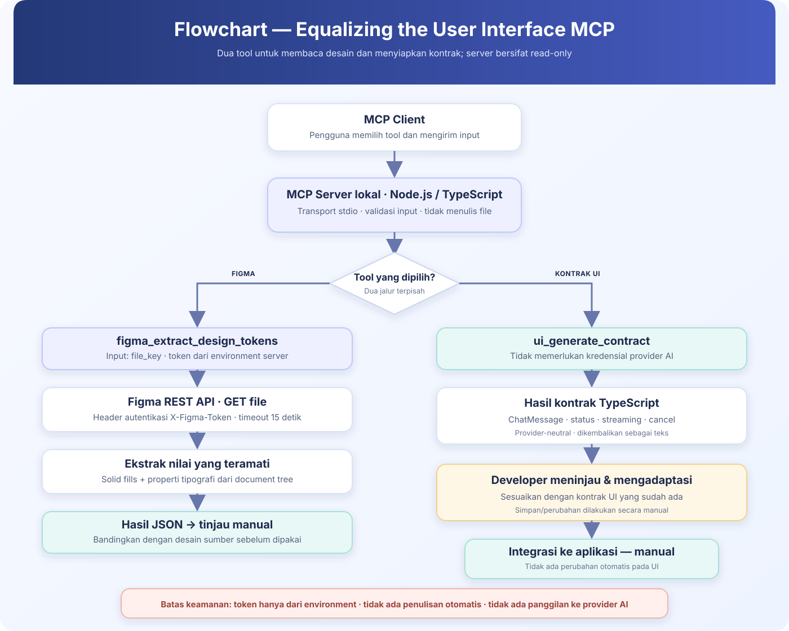

# Flowchart plugin MCP

Diagram ini menunjukkan dua tool yang tersedia, data yang dibaca/dihasilkan, serta batas read-only plugin. Ekstraksi Figma hanya mengembalikan nilai yang terlihat pada document tree; tinjau hasilnya sebelum digunakan. Kontrak UI dikembalikan sebagai teks dan harus diadaptasi secara manual.
